<div align="center">

# Projetor Android otimizado

**Como eu tirei o adware, destravei o ADB escondido e troquei a tela inicial de um projetor
Android barato por um launcher próprio no estilo macOS, mais leve que o do fabricante.**

Tutorial completo, do "não consigo nem ativar o modo desenvolvedor" até o launcher instalado,
com todas as dificuldades do caminho. Feito num Bettdow 1073, mas vale para a maioria dos
projetores e TVs Android genéricos com menu próprio do fabricante.


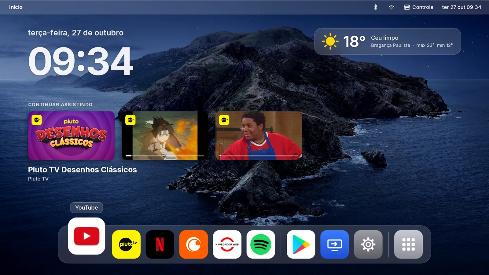

</div>

---

## Sumário

- [O problema](#o-problema)
- [O resultado](#o-resultado)
- [Telas](#telas)
- [Antes de começar](#antes-de-começar)
- [Passo 1 · Ativar o ADB quando o menu do fabricante esconde tudo](#passo-1--ativar-o-adb-quando-o-menu-do-fabricante-esconde-tudo)
- [Passo 2 · Conectar pelo computador](#passo-2--conectar-pelo-computador)
- [Passo 3 · Diagnóstico sem mexer em nada](#passo-3--diagnóstico-sem-mexer-em-nada)
- [Passo 4 · Limpeza: adware fora, sobras desativadas](#passo-4--limpeza-adware-fora-sobras-desativadas)
- [Passo 5 · O launcher próprio](#passo-5--o-launcher-próprio)
- [Passo 6 · Tornar o launcher a tela padrão (a parte mais difícil)](#passo-6--tornar-o-launcher-a-tela-padrão-a-parte-mais-difícil)
- [Passo 7 · Pluto TV travando](#passo-7--pluto-tv-travando)
- [Diário de bordo: tudo que deu errado](#diário-de-bordo-tudo-que-deu-errado)
- [Adaptar para o seu aparelho](#adaptar-para-o-seu-aparelho)
- [Compilar e instalar o launcher](#compilar-e-instalar-o-launcher)
- [Scripts](#scripts)
- [Decisões que não são óbvias](#decisões-que-não-são-óbvias)
- [Testes](#testes)
- [Como foi construído](#como-foi-construído)
- [Ainda não existe](#ainda-não-existe)
- [Créditos e avisos](#créditos-e-avisos)

---

## O problema

Projetor Android barato costuma vir assim:

- **Lento.** Dos 2 GB de RAM, cerca de 1 GB fica reservado para o processamento de imagem. O
  Android trabalha com o resto, e o launcher do fabricante sozinho ocupava mais de 100 MB.
- **Com propaganda.** A tela inicial é uma vitrine de anúncios de streaming.
- **Com adware escondido.** No meu, havia um app chamado `com.android.media.module.services`.
  O nome imita um componente do Android, mas foi **instalado em silêncio pelo próprio launcher do
  fabricante**, com módulos de SDK de anúncio e acesso a localização, ID de anúncio e lista de
  apps.
- **Trancado.** O menu de configurações é do fabricante, não do Android. Não existe "Número da
  versão" para clicar 7 vezes, então não dá para ativar o modo desenvolvedor do jeito normal.

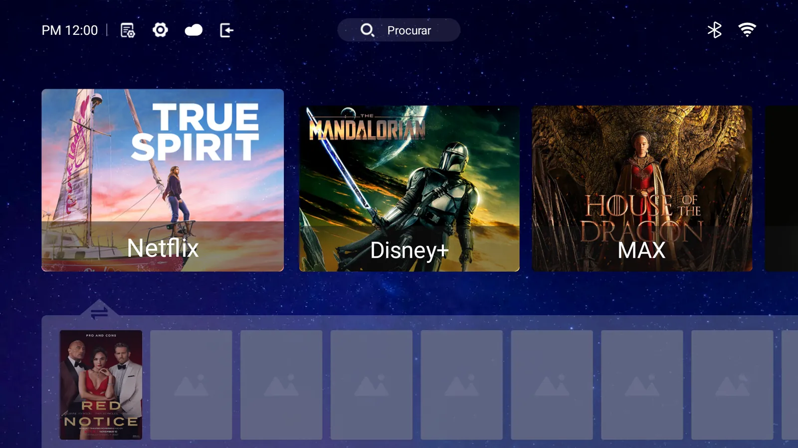

<sub>Tela inicial original do fabricante (antes).</sub>

## O resultado

| | Antes | Depois |
|---|---|---|
| Tela inicial | Launcher do fabricante, cheio de banners | Launcher próprio **Início**, estilo macOS |
| Memória da tela inicial | **101 MB** | **57 a 71 MB** |
| Abertura da tela inicial | 1,7 s | 0,75 a 1,1 s |
| Processador com a tela parada | 0% | 0% |
| Adware | 2 apps disfarçados | Removidos |
| Apps desnecessários rodando | Loja do fabricante, atualizador de terceiros e outros | Desativados (reversível) |
| Pluto TV, quadros travados ao navegar | 22% a 55% | 11% a 13% |

Todas as medições foram feitas no aparelho, com os scripts deste repositório (veja [Scripts](#scripts)).

O launcher tem barra de menu e Dock de vidro, Launchpad, Central de Controle com volume de
verdade, clima, calendário, troca automática de papel de parede, "Continuar assistindo" com o
que você estava vendo nos apps de streaming e um descanso de tela no estilo da tela de bloqueio
do Mac. Nada disso roda em segundo plano.

## Telas

Todas tiradas do projetor como ele está hoje, na versão 1.2 do launcher.

**Descanso de tela**, no estilo da tela de bloqueio do macOS: data e hora grandes, widgets de clima e
do último episódio, e as suas fotos passando com zoom lento. OK sai do descanso e já abre o episódio.

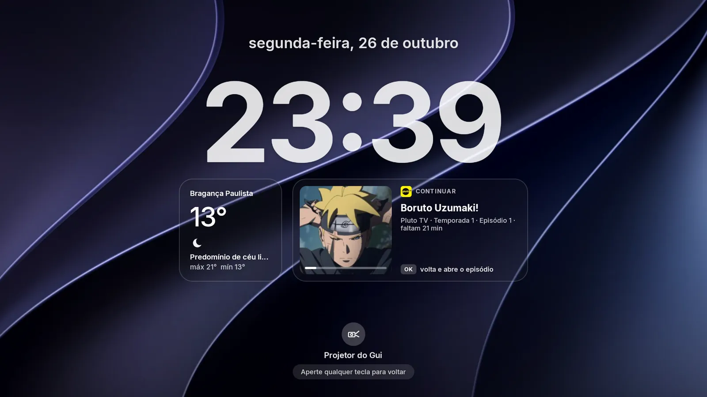

| "Continuar assistindo" com um episódio em foco | Menu "Início" |
|---|---|
| 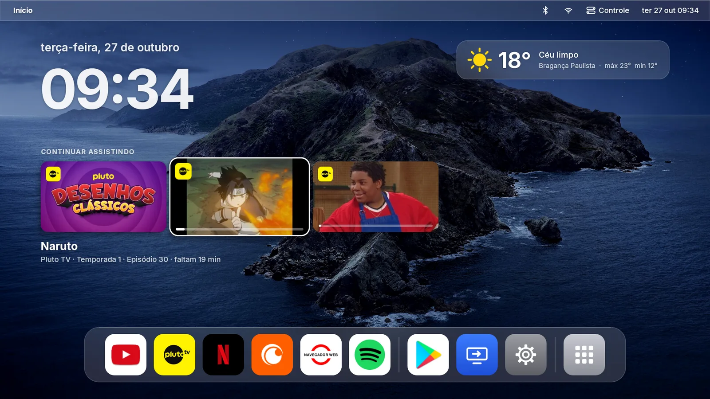 | 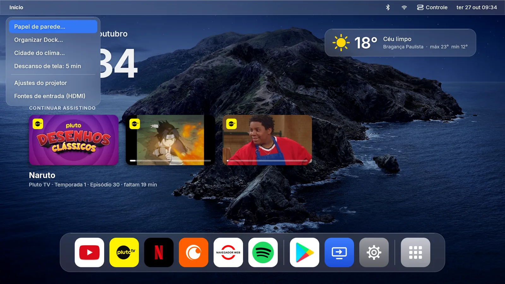 |

| Central de Controle com volume de verdade | Calendário |
|---|---|
| 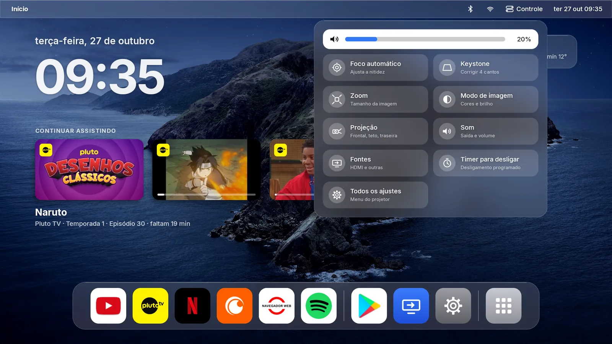 | 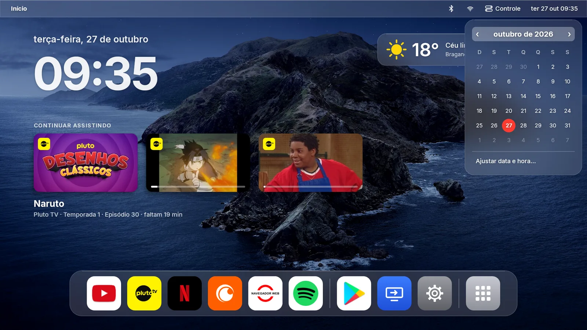 |

| Todos os apps, com ícones que preenchem o quadrado | Menu do app |
|---|---|
| 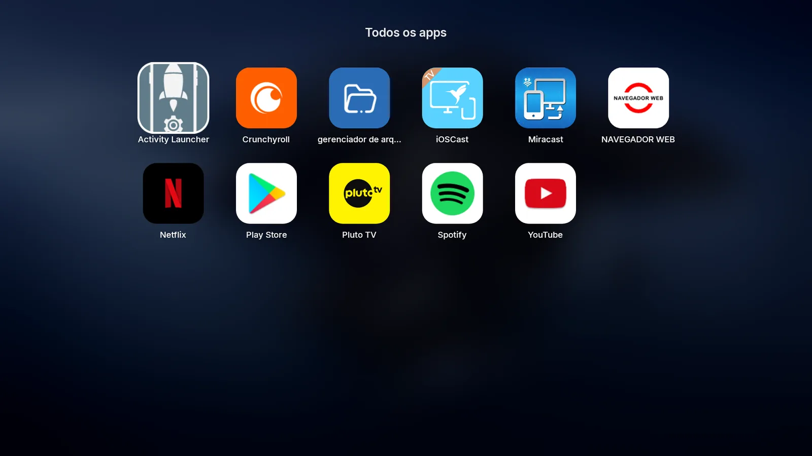 | 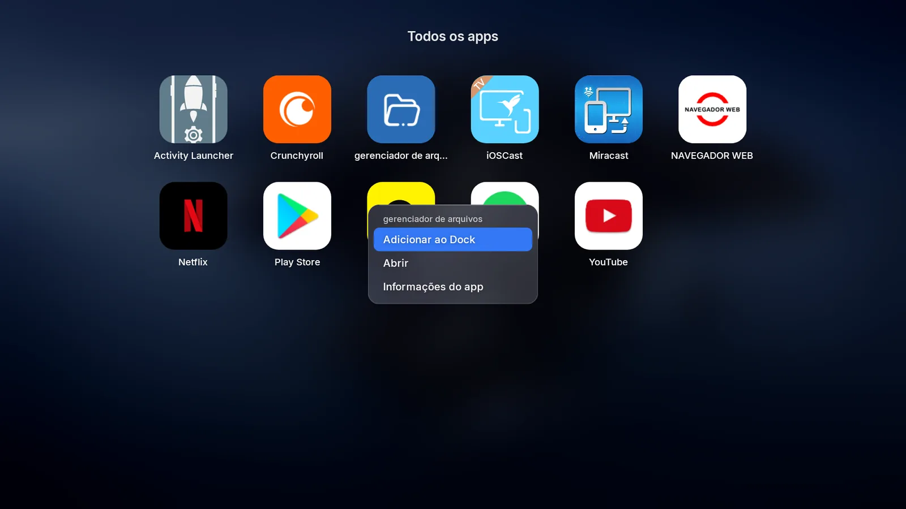 |

| Papel de parede e troca automática | Organizar Dock |
|---|---|
| 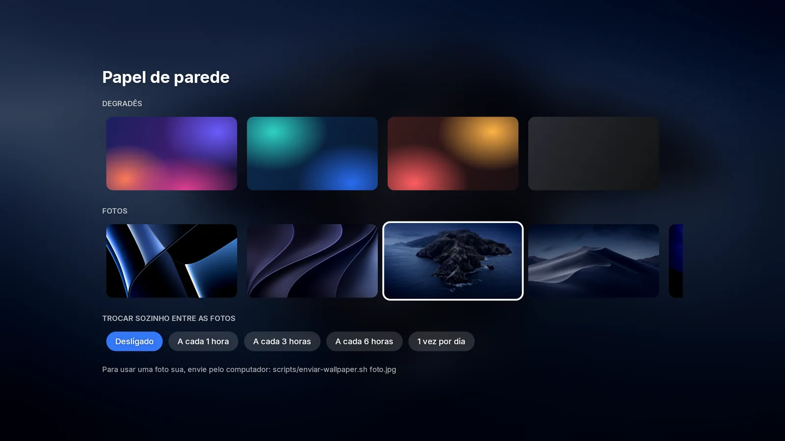 | 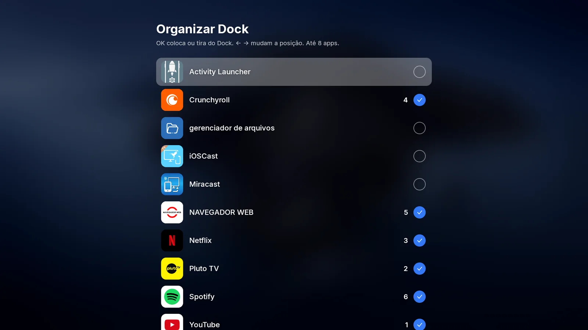 |

<p align="center">
  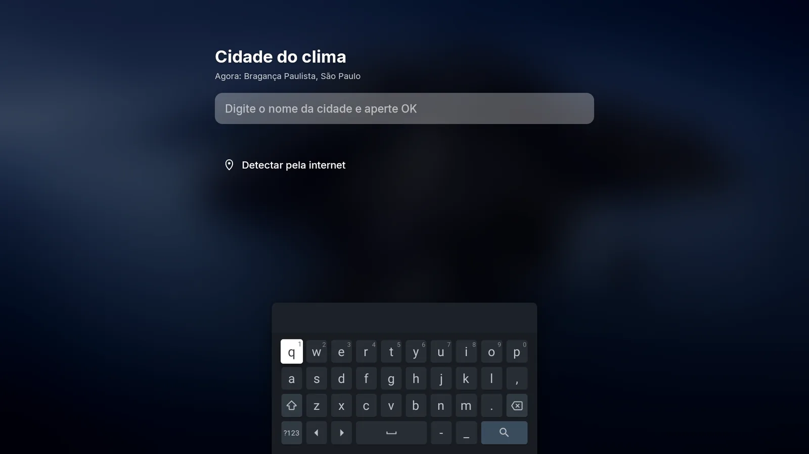
  <br><em>Cidade do clima: busca com o teclado na tela ou detecção pela internet</em>
</p>

<sub>Os papéis de parede de fotos nas capturas são os do macOS, enviados do meu computador. Eles não fazem parte do repositório.</sub>

---

## Antes de começar

**Do lado do computador**

- [Android Platform Tools](https://developer.android.com/tools/releases/platform-tools) (o `adb`).
  No Windows funciona direto; eu usei o WSL2 e o `adb connect` pela rede local funcionou sem
  configuração extra.
- Para compilar o launcher: JDK 17 ou mais novo e o Android SDK (o `sdkmanager` basta, não
  precisa do Android Studio).

**Do lado do projetor**

- Estar na mesma rede Wi-Fi que o computador.
- Anotar o IP dele: no meu, Configurações > Rede > Wi-Fi > (sua rede). Aqui vou usar
  `192.168.2.100`; troque pelo seu.

**Uma regra para tudo o que vem a seguir:** antes de mudar qualquer coisa, salve o estado atual.
Cada alteração deste tutorial tem o comando de volta anotado em [ALTERACOES.md](ALTERACOES.md), e
[scripts/reverter.sh](scripts/reverter.sh) desfaz tudo de uma vez.

---

## Passo 1 · Ativar o ADB quando o menu do fabricante esconde tudo

Esta foi a primeira parede, e é onde a maioria dos tutoriais não ajuda.

**O que os tutoriais mandam fazer:** ir em Sobre e clicar 7 vezes em "Número da versão" (ou, em
alguns projetores, 6 vezes no nome do aparelho). **No meu não funcionou**, porque o menu de
configurações não é o do Android: é uma tela do fabricante, traduzida automaticamente do chinês
("inscrição" quer dizer Aplicativos, "encontro" quer dizer Data e hora). Em "Sobre esta máquina"
só havia itens de leitura. Cliquei mais de 15 vezes em cada um e nada aconteceu.

**Por que isso acontece:** o app de configurações do Android continua instalado. O fabricante só
trocou a tela de entrada dele pela sua. As telas internas, inclusive Opções do desenvolvedor,
continuam lá, sem nenhum caminho até elas pela interface.

**O que tentei, na ordem, e o que funcionou:**

1. **ADB já ligado de fábrica?** Alguns projetores vêm com o ADB aberto na porta 5555. Teste
   antes de tudo:
   ```bash
   adb connect 192.168.2.100:5555
   ```
   No meu voltou `Connection refused`. Isso é diferente de *timeout*: *refused* quer dizer que a
   rede chega no projetor e só falta o serviço estar ligado. *Timeout* indicaria problema de rede.

2. **Activity Launcher pela Play Store do projetor:** não aparece. A loja de TV esconde apps que
   não foram feitos para TV.

3. **Um launcher de terceiros (Projectivy, que aparece na Play da TV):** ele lista o app
   "Configurações" que o fabricante escondia, mas, ao abrir, cai **na mesma tela do fabricante**.
   Ou seja, não basta achar o ícone: é preciso abrir uma tela interna específica.

4. **O que funcionou: Downloader + Activity Launcher do F-Droid.**
   - Na Play Store do projetor, instale o **Downloader** (ícone laranja, do AFTVnews). É um
     navegador de downloads feito para TV.
   - Abra o Downloader e digite `f-droid.org/packages/de.szalkowski.activitylauncher`.
   - Baixe o APK mais recente na página do F-Droid e mande instalar. O Android vai pedir
     **"Instalar apps desconhecidos"** para o Downloader. Essa tela é separada e abre mesmo com o
     menu do fabricante. Libere só para o Downloader.
   - Abra o **Activity Launcher**, procure **Configurações** (`com.android.settings` ou
     `com.android.tv.settings`) e abra as telas internas uma a uma. A que interessa é **Opções do
     desenvolvedor**. Se ela pedir para ativar antes, abra a tela **Sobre** por ali e clique 7
     vezes em **Número da versão** (ou "Build").

5. Em **Opções do desenvolvedor**, ligue **Depuração USB**.

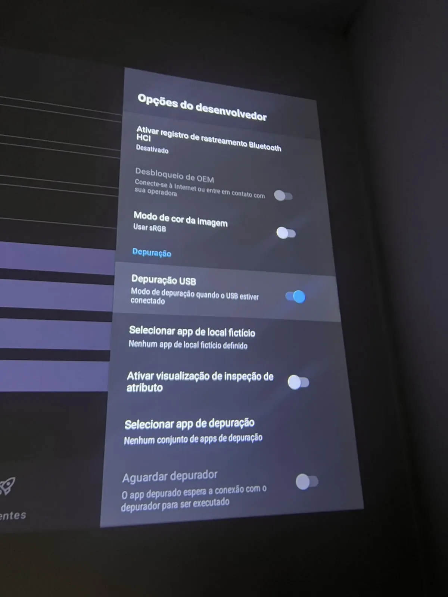

**Surpresa boa:** neste firmware, ligar a Depuração USB já abre o ADB **pela rede**, na porta fixa
5555. Não foi preciso o pareamento por código da "Depuração por Wi-Fi" do Android 11+. Se no seu
aparelho não for assim, entre em **Depuração por Wi-Fi > Parear dispositivo com código** e use
`adb pair IP:porta` com o código de 6 dígitos.

> **Cuidado:** com a Depuração USB ligada, qualquer aparelho da sua rede consegue se conectar ao
> projetor. Desligue quando não for mais mexer, ou só use em rede de confiança.

## Passo 2 · Conectar pelo computador

```bash
adb connect 192.168.2.100:5555
adb devices -l
```

Na primeira vez, o projetor mostra **"Permitir depuração?"**. Marque **"Sempre permitir"** e
confirme com o controle. O estado precisa aparecer como `device`; `unauthorized` quer dizer que a
pergunta ainda está na tela.

## Passo 3 · Diagnóstico sem mexer em nada

Antes de remover qualquer coisa, só leia. Estes comandos não alteram o aparelho:

```bash
adb shell getprop ro.build.version.release          # versão do Android
adb shell cat /proc/meminfo | head -5                # memória total e disponível
adb shell dumpsys meminfo | sed -n '/Total PSS by process/,/Total PSS by OOM/p'   # quem gasta RAM
adb shell pm list packages -3                        # apps instalados depois (fora do sistema)
adb shell pm list packages -f                        # todos, com o caminho do APK
adb shell dumpsys package NOME.DO.PACOTE | grep -E "installerPackageName|firstInstallTime|versionName"
```

O campo `installerPackageName` foi a pista principal: ele diz **quem instalou** cada app. O
`com.android.media.module.services` estava em `/data/app` (fora do sistema) e tinha sido
instalado pelo launcher do fabricante, sem passar pela Play Store. Abrindo o pacote, o código
interno se chamava `com.ad.service`, com serviços `MetaSdk`, `ZeroOneSdk` e `PluzedSdk`.

O relatório completo do meu aparelho está em [RELATORIO-DIAGNOSTICO.md](RELATORIO-DIAGNOSTICO.md):
classificação de todos os apps em essenciais, que você usa e dispensáveis, com ganho e risco de
cada um.

**Duas lições do diagnóstico:**

- Apps de fábrica que **não ficam rodando** (menus de teste, demos) não gastam memória.
  Desativá-los só aumenta o risco, sem ganho. Deixe-os quietos.
- Cerca de metade da RAM é reservada pelo hardware de vídeo ("Lost RAM" no `dumpsys meminfo`).
  Não espere milagre: o ganho real vem de tirar o que roda em segundo plano e de trocar o launcher.

## Passo 4 · Limpeza: adware fora, sobras desativadas

Primeiro, **guarde uma cópia** dos APKs que vai remover:

```bash
adb shell pm path com.android.media.module.services
adb pull /data/app/.../base.apk backup/apk/com.android.media.module.services/
```

Depois, dois métodos diferentes, de propósito:

```bash
# Apps em /data/app (instalados depois, como o adware): remover de verdade
adb uninstall com.android.media.module.services
adb uninstall com.android.docks

# Apps do sistema: só desativar. O APK continua lá e "pm enable" traz de volta na hora
adb shell pm disable-user --user 0 zeasn.open.technical.tv.store          # loja do fabricante
adb shell pm disable-user --user 0 com.mobisystems.editor.office_registered
adb shell pm disable-user --user 0 com.android.inputmethod.pinyin         # teclado chinês
adb shell pm disable-user --user 0 com.android.printspooler
adb shell pm disable-user --user 0 com.uv.droid.uota                      # atualizador de terceiros
adb shell pm disable-user --user 0 com.uv.droid.uotaback

# Animações mais rápidas
adb shell settings put global window_animation_scale 0.5
adb shell settings put global transition_animation_scale 0.5
adb shell settings put global animator_duration_scale 0.5
```

> **Cuidado com `pm uninstall --user 0` em app que veio da Play Store:** ele remove de vez.
> Aconteceu comigo com o Downloader durante os testes; foi só reinstalar pela Play, mas se for
> experimentar, faça `adb pull` do APK antes.

Depois de reiniciar (`adb reboot`), confira se o adware não voltou e se os apps que você usa
abrem normalmente. Aqui veio a **segunda surpresa**: o projetor ligou com a **tela toda preta**.
O registro do sistema mostrou que ele mesmo tinha aberto a **entrada HDMI 1** no boot, e não
havia nada ligado nela. A causa não era a limpeza: era a opção **"Entrada na inicialização"**
do menu do fabricante (em Outros ajustes). Ajuste-a para a tela inicial. No momento, um
`adb shell input keyevent HOME` resolve.

## Passo 5 · O launcher próprio

**Por que não usar um launcher pronto?** Medi no aparelho:

| Launcher | Memória |
|---|---|
| Original do fabricante | 87 a 101 MB |
| Projectivy (bonito, sem anúncios) | 88 MB |
| **Início** (este repositório) | **57 a 71 MB** |

O Projectivy é ótimo, mas pesa o mesmo que o do fabricante. Trocar um pelo outro tira o adware do
caminho, mas não libera memória. Então escrevi um do zero, em Kotlin, **sem nenhuma biblioteca**
(nem AndroidX), para cortar o peso que um app de TV comum carrega sem usar.

Antes do código vieram protótipos em HTML de várias disposições: estilo Projectivy, Apple TV,
menu lateral e macOS. A escolhida foi a do macOS. A especificação de cada versão está em
[docs/superpowers/specs](docs/superpowers/specs) e o plano de implementação em
[docs/superpowers/plans](docs/superpowers/plans).

**O que o Início tem:**

| | |
|---|---|
| **Barra de menu de vidro** | "Início" com o menu do launcher, Bluetooth, Wi-Fi, Central de Controle e data e hora. Tudo navegável pelo controle |
| **Dock de vidro** | Até 8 favoritos fixos. O ícone em foco cresce 30% e os vizinhos se afastam, como no Mac. Um app novo nunca entra sozinho |
| **Todos os apps** | Grade em páginas, ponto azul em app recém-instalado, menu para adicionar ao Dock |
| **Central de Controle** | Volume de verdade (← →), foco automático, keystone, zoom, modo de imagem, projeção, fontes, o desligamento programado do próprio projetor e **Liberar memória**, que fecha os apps parados antes de abrir um app pesado (no teste: de 176 MB para 343 MB livres) |
| **Calendário** | Mês inteiro na barra, como no macOS |
| **Clima** | Open-Meteo, sem conta e sem chave. Cidade detectada pela internet na primeira vez ou escolhida numa busca |
| **Papel de parede** | Degradês próprios ou fotos mandadas do computador, com troca automática a cada 1, 3, 6 horas ou 1 dia |
| **Continuar assistindo** | Lê a lista "Ver a seguir" que Pluto TV, Crunchyroll e YouTube publicam no Android TV. OK abre direto no episódio, no ponto em que parou |
| **Descanso de tela** | No estilo da tela de bloqueio do macOS: data e hora grandes, widgets de clima e do último episódio, fotos com zoom lento |
| **Ícones** | Ícones antigos (logo sobre fundo branco) passam a preencher o quadrado com a própria cor, como no iPhone |

O que ele **não** faz, de propósito: nada roda em segundo plano. Sem serviço, sem sincronização,
sem vídeo de fundo. Com a tela parada, o processador fica em 0%.

## Passo 6 · Tornar o launcher a tela padrão (a parte mais difícil)

Em um Android normal, basta instalar o launcher, apertar Início e escolher "Sempre". **Neste
firmware não funcionou**, e entender o porquê levou um tempo:

1. O botão Início não abre a tela padrão do Android. Ele abre uma tela intermediária do
   fabricante, `com.newlink.provision/.FallbackHome`.
2. Essa tela lê uma chave própria, `settings global nl_curr_home_launcher`, e abre o app que
   estiver nela, pela categoria `LAUNCHER` (e não `HOME`).
3. O launcher do fabricante **regrava essa chave toda vez que roda**. Mudar a chave com ele aberto
   não adianta.

O que resolveu:

```bash
# 1. O launcher precisa declarar também a categoria LAUNCHER (o Início já declara, veja o AndroidManifest)
# 2. Parar o launcher do fabricante antes de mudar a chave
adb shell am force-stop com.zeasn.launcher.projector
adb shell settings put global nl_curr_home_launcher br.gui.inicio
adb shell cmd package set-home-activity br.gui.inicio/.home.HomeActivity
# 3. Depois de testar bem o novo, desativar o do fabricante (foi ele que instalou o adware)
adb shell pm disable-user --user 0 com.zeasn.launcher.projector
```

Para voltar atrás, os comandos estão em [ALTERACOES.md](ALTERACOES.md), itens 10 e 12.

## Passo 7 · Pluto TV travando

A Pluto TV demorava para abrir e engasgava ao navegar. Medi com
[scripts/medir-pluto.sh](scripts/medir-pluto.sh) e descobri duas causas:

- **O app ficou pesado.** A versão 17.x, de setembro de 2026, foi refeita sobre a base do app da
  Paramount+. Segundo uma [análise das avaliações da Play Store](https://unstar.app/blog/pluto-tv-update-cant-change-channels-mute-button-reviews-2026),
  as reclamações triplicaram nos dias seguintes a essa atualização.
- **O fabricante fecha os apps à força.** O gerenciador de memória do firmware
  (`com.sstar.systemcontrol`) força o fechamento de quem sai da frente. Por isso a Pluto quase
  sempre abre do zero.

O que resolveu: voltar para a **5.65.0-leanback**, a última versão feita para TV antes do
redesenho, e compilá-la por completo. **A assinatura digital foi conferida peça por peça**
contra a da versão instalada pela Play Store antes de instalar:

```bash
apksigner verify --print-certs base.apk     # o SHA-256 do certificado tem que ser igual ao da versão da Play
adb uninstall tv.pluto.android               # voltar de versão exige desinstalar
adb install-multiple base.apk split_config.armeabi_v7a.apk split_config.pt.apk split_config.en.apk split_config.xhdpi.apk
adb shell cmd package compile -m speed -f tv.pluto.android
```

| Pluto TV (compilada por completo) | Quadros travados | 90% dos quadros em até |
|---|---|---|
| 17.2, tela inicial | 22% a 55% | 150 ms a 4,9 s |
| 5.65 para TV, guia de canais | 11% a 13% | 26 a 38 ms |

O tempo de abertura não mudou (cerca de 19 s até o vídeo tocar): isso é limite do aparelho. A
navegação, sim. A 5.65 pede uma conta gratuita da Pluto. A Play Store pode atualizar o app
sozinha de volta para a 17.x; [scripts/trocar-pluto.sh](scripts/trocar-pluto.sh) troca entre as
duas. **Não incluí os APKs da Pluto no repositório**: baixe de uma fonte que publica a assinatura
(eu usei o APKMirror) e confira antes de instalar.

---

## Diário de bordo: tudo que deu errado

<details>
<summary><strong>Os 6 cliques do vídeo e os 7 cliques do Android não existiam no menu</strong></summary>

<br>

O tutorial que me inspirou era de outro projetor (Touyinger Q13W), em que o atalho é clicar 6
vezes no nome do aparelho. No Bettdow, o menu é do fabricante e não tem "Número da versão".
Solução no [Passo 1](#passo-1--ativar-o-adb-quando-o-menu-do-fabricante-esconde-tudo).

</details>

<details>
<summary><strong>O Activity Launcher não aparece na Play Store da TV</strong></summary>

<br>

A Play de TV filtra apps que não declaram suporte a TV. Um launcher de terceiros mostrou o ícone
"Configurações", mas ele abria a tela do fabricante. O caminho foi o Downloader baixando o
Activity Launcher direto do F-Droid.

</details>

<details>
<summary><strong>Tela preta depois de reiniciar</strong></summary>

<br>

O projetor ligou num retângulo preto. Não era defeito: o próprio sistema abriu a entrada HDMI 1
no boot (opção "Entrada na inicialização"). Um `adb shell input keyevent HOME` trouxe a tela de
volta, e o ajuste certo é feito no menu do fabricante.

</details>

<details>
<summary><strong>Remover o Downloader removeu de vez</strong></summary>

<br>

`pm uninstall --user 0` num app da Play Store não é só "esconder": removeu. Bastou reinstalar
pela Play. Desde então, `adb pull` do APK vem antes de qualquer remoção.

</details>

<details>
<summary><strong>O launcher novo não virava a tela padrão</strong></summary>

<br>

O `set-home-activity` do Android era ignorado. A tela intermediária do fabricante lê uma chave
própria e o launcher dele a regrava sempre que roda. Detalhes no
[Passo 6](#passo-6--tornar-o-launcher-a-tela-padrão-a-parte-mais-difícil).

</details>

<details>
<summary><strong>Degradês com faixas visíveis</strong></summary>

<br>

O projetor desenha em 16 bits por padrão (RGB_565) e os degradês ficavam listrados. Fundos e fotos
passaram a ser gerados em cor cheia (ARGB_8888). Os degradês são calculados em meia resolução e
ampliados, o que mantém a memória baixa sem faixas.

</details>

<details>
<summary><strong>O teste automático quase desconectou o controle Bluetooth</strong></summary>

<br>

Uma sequência de teclas mandada às cegas pelo ADB foi parar no menu do controle remoto, com
"desconectar" em destaque. Nada foi apertado ali, mas desde então todo OK dos testes passa por
[scripts/qa-seguro.sh](scripts/qa-seguro.sh), que só aperta se a tela for do launcher e o item em
foco for o esperado.

</details>

<details>
<summary><strong>O fabricante fechava o meu launcher</strong></summary>

<br>

Aberto direto pelo componente (`am start -n`) logo depois de um `force-stop`, o launcher era
fechado à força pelo gerenciador de memória do fabricante (`com.sstar.systemcontrol`) e o
Android mostrava o último app usado. Aberto pelo caminho do botão Início, ele fica numa lista de
proteção. Os scripts passaram a abrir sempre pelo `intent` HOME.

</details>

<details>
<summary><strong>Memória crescendo durante a noite</strong></summary>

<br>

A revisão de código encontrou: a cada troca automática de papel de parede, o esmaecimento
guardava a foto anterior dentro da nova. Em uma noite, seriam dezenas de megabytes. Agora o
esmaecimento parte só da camada de cima e, ao terminar, sobra só a foto nova.

</details>

<details>
<summary><strong>Boruto aparecendo duas vezes no "Continuar assistindo"</strong></summary>

<br>

A Pluto publicou o mesmo episódio duas vezes, com título, capa e link diferentes (formato antigo e
novo do app). O único ponto em comum era o código do episódio dentro dos endereços. A launcher
agora junta entradas do mesmo app que compartilham esse código e mostra só a mais recente.

</details>

<details>
<summary><strong>A Pluto ignorava o link do episódio</strong></summary>

<br>

Com o app já aberto, ele recebia o link e ficava na tela em que estava. Abrindo numa tarefa nova
(`FLAG_ACTIVITY_CLEAR_TASK`), ele processa o link e vai direto ao player, no ponto em que parou.

</details>

<details>
<summary><strong>Timer para desligar: o atalho que eu não usei</strong></summary>

<br>

Dava para desligar o projetor por conta própria explorando uma permissão mal configurada do
serviço de energia do fabricante. Descartei: contornar a proteção do sistema não é algo que um
launcher deve fazer. O bloco "Timer para desligar" abre a tela oficial de desligamento
programado do projetor.

</details>

<details>
<summary><strong>Netflix com o erro -1007, e o atalho escondido que virava as setas em volume</strong></summary>

<br>

A Netflix que vem de fábrica (8.87, de abril de 2025) passou a mostrar "Não foi possível acessar
o serviço Netflix (-1007)". Rede e DNS estavam certos: o servidor recusava a versão antiga.
Atualizei para a 9.89 (APKMirror, mesmo certificado da de fábrica). A versão para TV
(`com.netflix.ninja`) não serve: este projetor não tem certificação da Netflix, e ela trava ou
diz que o aparelho não é compatível.

A 9.89 é a versão de celular e não desenha foco. Pior: o firmware tem um ajuste escondido no
`framework.jar` que simula o foco na Netflix procurando botões por IDs fixos da 8.87. Na 9.89 ele
se perde e as setas do controle passam a mudar o volume. Ele liga pela propriedade
`sys.nl.netflix.simulate.focus.control`, lida quando a base dos apps inicia. O que resolveu de
verdade foi usar o mouse aéreo do controle, que dispensa o foco.

</details>

<details>
<summary><strong>HBO Max e Stremio: funcionaram, e eu desinstalei</strong></summary>

<br>

A HBO Max para TV é recusada pelo servidor (o mesmo problema de certificação). A de celular
7.0.0.82 funciona com o mouse aéreo, em 768x384 por causa da proteção de vídeo básica (Widevine
L3); a 7.14 trava na escolha de perfil e a 6.10 é recusada. O Stremio instala pela Play Store
sem drama. Mas os dois voltavam a rodar sozinhos sem ninguém abrir, por gatilhos de inicialização
e notificação: uns 46 MB ocupados o tempo todo num aparelho que trabalha com 250 MB livres. Como
eu não ia usar, desinstalei. App instalado e parado só ocupa armazenamento; o problema é app que
acorda sozinho.

</details>

---

## Adaptar para o seu aparelho

O tutorial vale para qualquer Android TV ou projetor Android. O que muda de aparelho para aparelho:

| O que | Onde mudar |
|---|---|
| Pacotes do fabricante a desativar | Seu diagnóstico (Passo 3). Os nomes do meu estão em [ALTERACOES.md](ALTERACOES.md) |
| Atalhos da Central de Controle (keystone, zoom, foco) | [`Shortcuts.kt`](launcher/app/src/main/java/br/gui/inicio/data/Shortcuts.kt): cada atalho tenta uma ação padrão do Android e depois a tela do fabricante. Descubra as suas com `adb shell cmd package query-activities` |
| Tela padrão | Passo 6. Em aparelhos sem a tela intermediária do fabricante, o `set-home-activity` sozinho resolve |
| Nome no descanso de tela | `DEVICE_NAME` em [`ScreensaverView.kt`](launcher/app/src/main/java/br/gui/inicio/home/ScreensaverView.kt) |
| IP do projetor nos scripts | Variável `DEV=IP:5555` ou o argumento de cada script |

## Compilar e instalar o launcher

```bash
cd launcher
cp keystore.properties.example keystore.properties   # e preencha (veja abaixo)
./gradlew :app:testDebugUnitTest                       # 97 testes, sem aparelho
./gradlew :app:assembleRelease
adb install -r app/build/outputs/apk/release/app-release.apk
```

A chave de assinatura é sua: crie uma vez e **guarde uma cópia**. Sem ela, para atualizar o
launcher é preciso desinstalar antes.

```bash
keytool -genkeypair -v -keystore inicio.jks -alias inicio -keyalg RSA -keysize 2048 -validity 10000
```

Só quer experimentar? `./gradlew :app:assembleDebug` gera um APK de teste assinado
automaticamente, em `app/build/outputs/apk/debug/`.

**Requisitos do launcher:** Android 12 ou mais novo (minSdk 31), tela 16:9. As medidas são
pensadas para 1920x1080 e escalam para outras resoluções.

## Scripts

| Script | O que faz |
|---|---|
| [`scripts/reverter.sh`](scripts/reverter.sh) | Desfaz tudo: reativa apps, devolve o launcher do fabricante, volta a Pluto da Play |
| [`scripts/enviar-wallpaper.sh`](scripts/enviar-wallpaper.sh) | Recorta uma foto em 1920x1080 no computador e manda para o launcher |
| [`scripts/medir-launcher.sh`](scripts/medir-launcher.sh) | Memória, tempo de abertura e processador parado do launcher, em rodadas |
| [`scripts/medir-pluto.sh`](scripts/medir-pluto.sh) | Abertura e quadros travados da Pluto TV ao navegar |
| [`scripts/trocar-pluto.sh`](scripts/trocar-pluto.sh) | Alterna a Pluto entre a versão leve para TV e a da Play Store |
| [`scripts/qa-seguro.sh`](scripts/qa-seguro.sh) | Funções de teste por ADB que só apertam OK se a tela e o item em foco forem os esperados |

## Decisões que não são óbvias

<details>
<summary><strong>Nenhuma biblioteca, nem AndroidX</strong></summary>

<br>

Cada biblioteca soma memória na abertura de um app que fica aberto o dia inteiro. A interface
inteira usa só as Views do Android. O APK final tem cerca de 2 MB.

</details>

<details>
<summary><strong>Vidro sem desfoque ao vivo</strong></summary>

<br>

Desfoque em tempo real custa processamento a cada quadro. O papel de parede é desfocado **uma vez**,
em 1/8 do tamanho, e cada painel de vidro só recorta o pedaço que fica atrás dele.

</details>

<details>
<summary><strong>Nada em segundo plano</strong></summary>

<br>

Clima, "Continuar assistindo" e troca de fundo só trabalham quando a tela inicial aparece. A foto
da vez da troca automática é calculada pelo relógio (`instante / intervalo`, módulo o número de
fotos), sem nenhum processo marcando tempo.

</details>

<details>
<summary><strong>A tela inicial não pode cair</strong></summary>

<br>

Uma launcher que trava deixa o aparelho sem tela. Todo trabalho fora da tela passa por
`Guard.run`, que transforma qualquer erro (inclusive falta de memória) num valor de reserva e
registra no log.

</details>

<details>
<summary><strong>O link do episódio só abre o app que o publicou</strong></summary>

<br>

O "Continuar assistindo" executa links vindos de outros apps. Um link que aponte para outro app,
ou para telas internas da própria launcher, é recusado, e o cartão abre o app de origem.

</details>

<details>
<summary><strong>Capas guardadas, e gravadas de forma atômica</strong></summary>

<br>

As capas dos episódios vêm da internet só na primeira vez. Depois a fileira aparece em menos de
meio segundo. Cada capa é baixada para um temporário, recortada e só então renomeada: se o
processo morrer no meio, não fica imagem pela metade no cache.

</details>

<details>
<summary><strong>Ícone antigo vira quadrado cheio, ícone adaptativo fica como está</strong></summary>

<br>

A launcher amostra 12 pontos da borda do ícone. Se a borda é opaca (Pluto, Crunchyroll), o ícone
ocupa o quadrado inteiro e o que sobrar ganha a cor dele. Se é transparente (Play Store), o logo
fica centralizado sobre o branco. Assim, app instalado depois também fica bonito sem ajuste manual.

</details>

## Testes

106 testes da lógica pura, sem aparelho e sem emulador:

```bash
cd launcher && ./gradlew :app:testDebugUnitTest
```

Eles defendem decisões, não só o caminho feliz:

- a troca de foto por horário dá o mesmo resultado em qualquer aparelho e não precisa de processo
  rodando
- a tecla que acorda do descanso é consumida inteira, inclusive quando segurada
- relógio que volta no tempo conta como clima velho
- o mesmo episódio publicado duas vezes, com título e capa diferentes, aparece uma vez só
- link de episódio para outro app é recusado
- à noite o clima não diz "Predomínio de sol"

No aparelho, cada versão teve um roteiro escrito antes do teste e executado com capturas:
[docs/qa](docs/qa).

## Como foi construído

Comecei a partir de um vídeo em que alguém otimizava o próprio projetor com a ajuda do
[Claude Code](https://claude.com/claude-code), e fiz o mesmo: o Claude Code rodou os comandos ADB,
escreveu e testou o launcher e mediu cada versão no aparelho, enquanto eu decidia o que manter, o
design e o que valia o risco.

O processo seguiu uma ordem fixa: diagnóstico só de leitura, aprovação antes de qualquer
alteração, protótipos antes do código, especificação, testes antes da implementação, revisão de
código independente e roteiro de testes no aparelho. Os documentos de cada etapa estão neste
repositório:

| Documento | O que tem |
|---|---|
| [RELATORIO-DIAGNOSTICO.md](RELATORIO-DIAGNOSTICO.md) | Estado do aparelho antes de qualquer mudança |
| [ALTERACOES.md](ALTERACOES.md) | Cada alteração, com o comando usado e o de volta |
| [RELATORIO-FINAL.md](RELATORIO-FINAL.md) | Antes e depois, com as medições |
| [CHANGELOG.md](CHANGELOG.md) | Versões 1.0, 1.1 e 1.2 do launcher |
| [docs/superpowers](docs/superpowers) | Especificações e plano de implementação |
| [docs/qa](docs/qa) | Roteiros e resultados dos testes no aparelho |

## Ainda não existe

Fotos pelo pendrive, Dock que se reorganiza pelo uso, tema claro, outras resoluções além de 16:9 e
suporte a Android anterior ao 12.

## Créditos e avisos

- Fonte [Inter](https://rsms.me/inter/), de Rasmus Andersson, licença SIL OFL 1.1
  ([docs/LICENCA-INTER.txt](docs/LICENCA-INTER.txt)).
- Clima: [Open-Meteo](https://open-meteo.com). Cidade pelo IP: [GeoJS](https://www.geojs.io).
- Projeto pessoal, sem relação com Bettdow, Apple, Pluto TV ou qualquer marca citada. Os nomes
  aparecem só para descrever o aparelho e os apps.
- Mexer no seu aparelho é por sua conta. Tudo aqui foi feito sem root e é reversível, mas leia
  cada comando antes de rodar.

## Licença

MIT. Veja [LICENSE](LICENSE).
